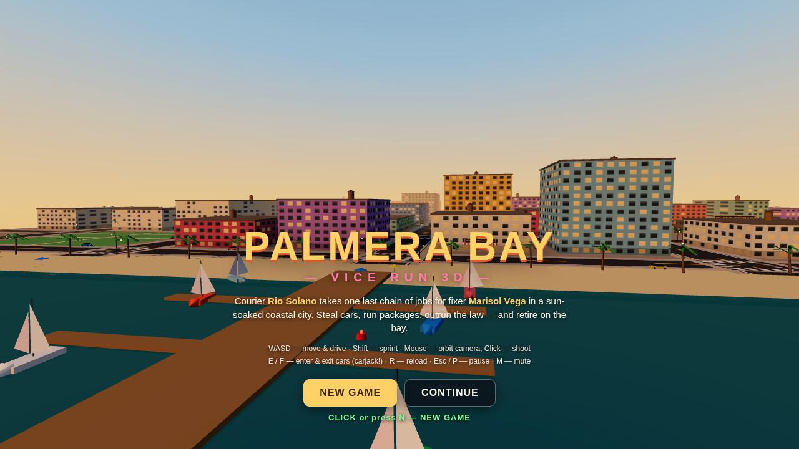
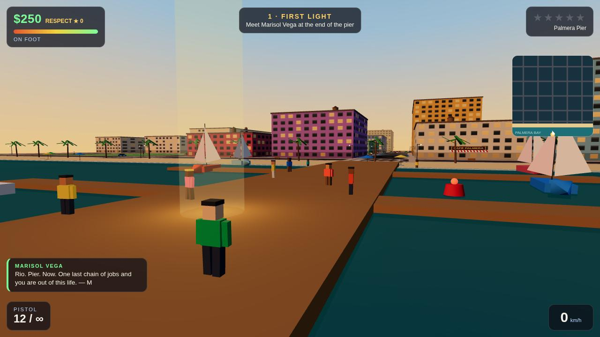
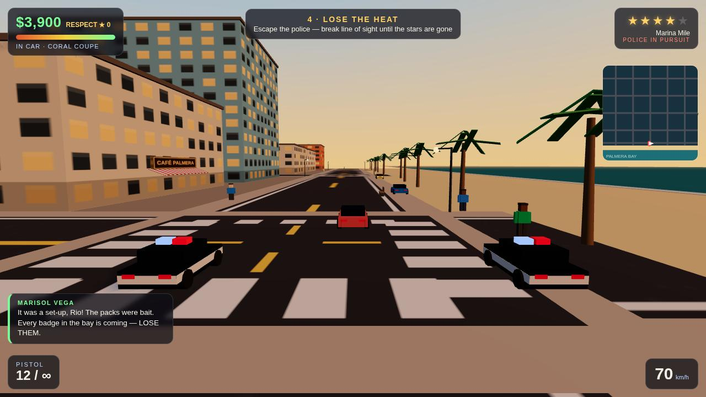
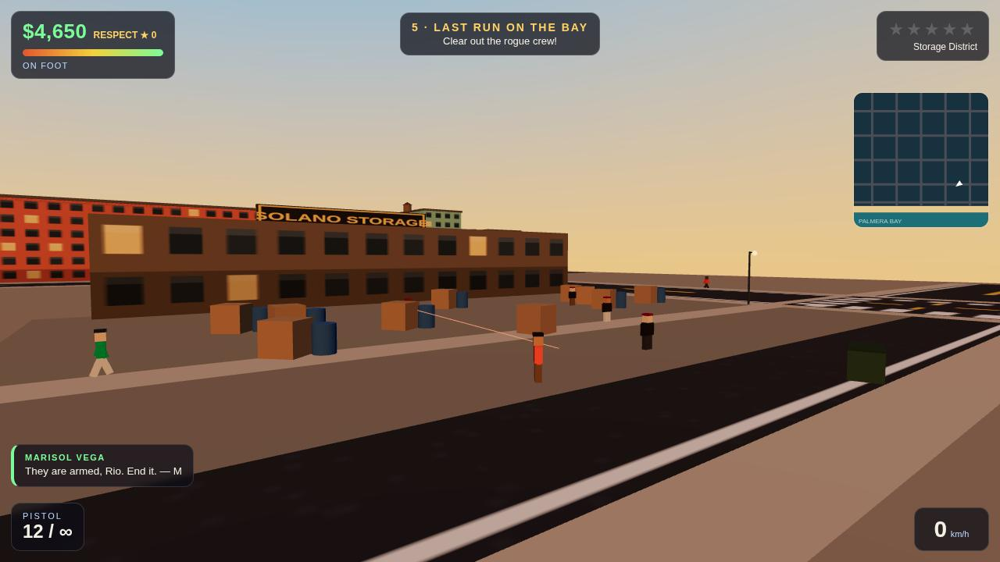

[](https://make.fun/bounty/gta6-01?utm_source=github&utm_medium=readme&utm_campaign=gta6-01)
[](https://make.fun/bounty/gta6-01/leaderboard?utm_source=github&utm_medium=readme&utm_campaign=gta6-01)
[](https://make.fun/bounty/gta6-01?utm_source=github&utm_medium=readme&utm_campaign=gta6-01)

# Palmera Bay: Vice Run 3D

An original **third-person 3D open-world crime game** for the browser, built with
[Three.js](https://threejs.org/) (vendored, no build step, no network requests). One last chain
of jobs in a sun-soaked coastal city at golden hour: steal cars, run packages, outrun the law —
and retire on the bay.

Entry for the make.fun bounty **[Make GTA 6 (gta6-01)](https://make.fun/bounty/gta6-01)**.



## The story

Courier **Rio Solano** is done with the life — almost. Fixer **Marisol Vega** offers one last
chain of jobs, wired to Rio's phone as the city wakes up around him: a meeting on the pier, a
stolen coral coupe, four scattered packages, a police ambush, and a final reckoning at the
Solano Storage yard. Finish the chain and Palmera Bay is yours: free roam with paid delivery
side jobs.

| # | Mission | What happens |
|---|---------|--------------|
| 1 | **First Light** | Meet Marisol Vega at the end of Palmera Pier. |
| 2 | **Coral Coupe** | Steal the coral coupe on Marina Mile and deliver it to Solano Storage — mind the alarm. |
| 3 | **Scattered Packs** | Collect 4 packages hidden around the city, $200 each. |
| 4 | **Lose the Heat** | The packs were bait. Escape a 4-star police ambush until the stars are gone. |
| 5 | **Last Run on the Bay** | Clear the rogue crew out of the storage yard, then reach the pier. **$5,000.** |

## Screenshots

| | |
|---|---|
|  |  |
|  |  |

## Features

- **A living coastal city** — 40+ dressed buildings (procedural window textures, lit windows,
  rooftop water tanks and AC units, parapets, striped awnings, named sign boards: HOTEL SOL,
  BANCO AZUL, MERCADO, CLÍNICA DEL SOL, CAFÉ PALMERA…), road grid with lane markings,
  crosswalks and stop lines, sidewalks, two parks, palms, streetlights, benches, planters and
  dumpsters.
- **Beach & marina** — sand strip with umbrellas and towels, an animated ocean with foam line
  and bobbing buoys, a pier with finger docks and seven moored sailboats.
- **On foot** — third-person character with swinging-limb walk/sprint animation and a
  mouse-orbit camera.
- **Driving & carjacking** — press E/F to enter *any* car: traffic, parked cars, the coral
  coupe, even police cars (extra wanted stars, extra respect). Arcade physics, collisions,
  spinning wheels, brake lights, chase camera.
- **Traffic AI** — cars loop the road grid in right-hand lanes and brake for the car ahead.
- **Pedestrians** — crowds stroll the sidewalks and the promenade, and flee from gunfire and
  fast cars.
- **Police & wanted system** — lightbar-flashing units chase and ram; wanted level 1–5 stars
  decays when you break line of sight. Get cornered on foot and you're **BUSTED**; run out of
  health and you're **WASTED** — either way you wake up at Clínica del Sol, $100 lighter.
- **Combat** — raycast pistol (12-round magazine, R to reload), muzzle flash, tracers both
  ways, an armed crew in the finale, and cash drops from defeated enemies.
- **HUD & minimap** — cash, respect, health bar, wanted stars, district name, speedometer,
  ammo, mission objective banner, Marisol's phone messages, and a live minimap with roads,
  ocean, police blips, the coupe and the mission marker.
- **Save & pause** — progress autosaves to `localStorage` (Continue on the title screen);
  Esc/P pauses.
- **Synthesized sound** — WebAudio engine, sirens, horns, gunshots, pickup chimes and a bass
  loop. No audio assets. M mutes.

## Controls

| Key | Action |
|-----|--------|
| WASD / arrows | Move on foot · accelerate / brake / steer in a car |
| Shift | Sprint |
| Mouse (click to lock) | Orbit camera |
| Click | Shoot (on foot) |
| E / F | Enter / exit a car (carjack!) |
| R | Reload |
| Esc / P | Pause |
| M | Mute |

## How to play

Serve the game folder with any static server — from the repo root:

```
node serve.ts            # then open http://localhost:8080
```

or run the entry program, which copies the game and screenshots and writes the dossier:

```
mkdir -p out && MAKEFUN_OUTPUT_DIR=out node main.ts
```

Click **NEW GAME** (or press N), read Marisol's message, and follow the gold beacon. The
minimap marker always points at your current objective.

## Source structure

| Path | Contents |
|------|----------|
| `main.ts` | Entry program: copies `game/` + `screenshots/` and writes `dossier.json` (kit plumbing). |
| `serve.ts` | Tiny static server for local play. |
| `game/index.html` | Page shell: HUD, title screen, phone banner, minimap canvas, import map. |
| `game/src/main.js` | Game state, input, cameras, driving, combat, missions, HUD + minimap, staged screenshot scenes. |
| `game/src/world.js` | Palmera Bay itself: sky, sun, roads, buildings, signs, parks, beach, marina, props, colliders. |
| `game/src/actors.js` | Car/person factories, traffic AI, police AI, pedestrian crowd. |
| `game/src/audio.js` | Synthesized WebAudio: engine, siren, horns, shots, bass loop. |
| `game/src/rng.js` | Seeded RNG for deterministic scenes. |
| `game/vendor/three.module.min.js` | Three.js r160, vendored (MIT). |
| `screenshots/` | The four 1280×720 screenshots referenced by `shots.json`. |

Deterministic screenshot scenes for review: open the game with
`?shot=title`, `?shot=onfoot`, `?shot=chase` or `?shot=mission` (with `&seed=1`).

## License

MIT — see `LICENSE`. Three.js is MIT-licensed by its authors.
